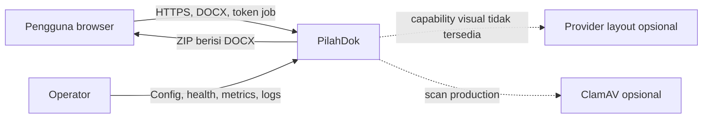
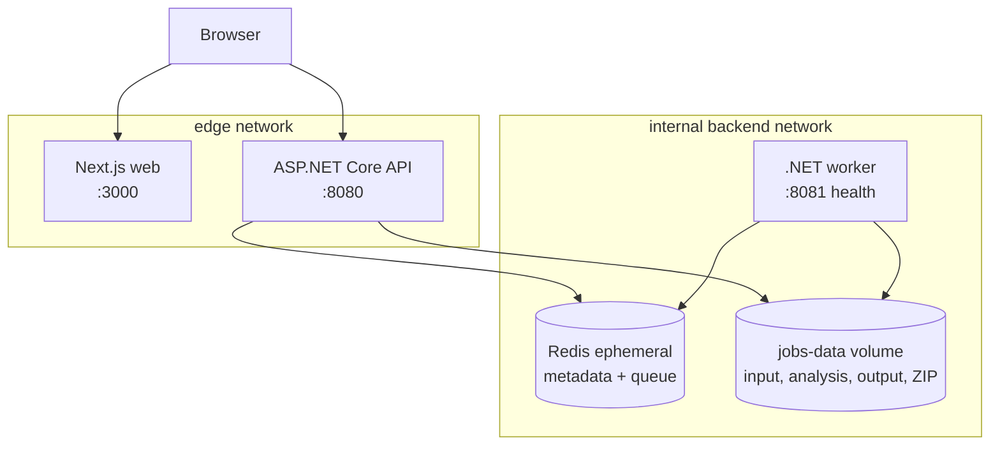
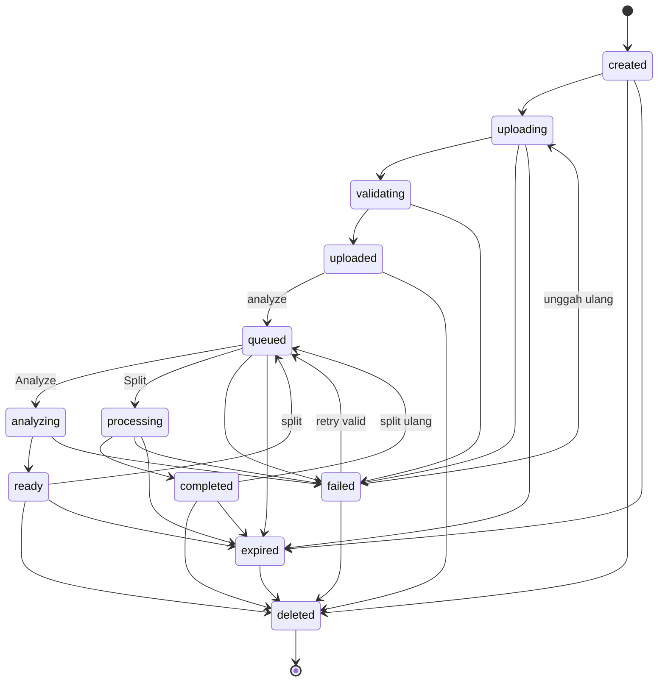

# Arsitektur PilahDok

## Ringkasan

Runtime native kini menjadi jalur utama sesuai instruksi pengguna. Windows memakai `scripts/start-local.ps1`; Linux produksi memakai service web/API/worker dengan systemd, Redis privat, storage absolut bersama, dan Nginx TLS. Lihat [deployment native](deployment-native.md). Docker tetap opsional.

PilahDok memakai pemisahan control plane dan processing plane. API menangani trust boundary HTTP, Redis menyimpan metadata/queue sementara, sedangkan worker menjadi satu-satunya komponen yang menganalisis atau mengubah DOCX. API dan worker berbagi temporary filesystem melalui volume lokal untuk development. Interface store/file/pagination menjaga jalur migrasi ke object storage atau provider layout production.

## System context



## Container architecture



Redis, worker, dan volume tidak dipublish ke host. Runtime container non-root, read-only, drop all capabilities, memakai `no-new-privileges`, resource limits, dan tmpfs. `backend` adalah internal network. Renderer eksternal tidak dijalankan karena tidak dipakai fitur saat ini; pagination visual tetap unavailable.

## Sequence upload sampai delete

```mermaid
sequenceDiagram
    actor U as Pengguna
    participant W as Web
    participant A as API
    participant R as Redis
    participant F as Temporary files
    participant K as Worker

    U->>W: Pilih DOCX
    W->>A: POST /jobs
    A->>R: Simpan hash token + TTL
    A-->>W: jobId + access/download token
    W->>A: PUT /document (stream)
    A->>F: source.docx
    A->>A: Validasi ZIP/OOXML/XML + AV
    W->>A: POST /analyze
    A->>R: Queue Analyze
    K->>R: Ambil job
    K->>F: Analisis struktur -> analysis.json
    W->>A: Poll status + GET analysis
    A-->>W: Kandidat struktural
    U->>W: Pilih titik + rename
    W->>A: POST /split
    A->>R: Queue Split
    K->>F: Clone package, trim body, validate output
    K->>F: manifest.json + result.zip
    W->>A: GET /download dengan token khusus
    A-->>U: ZIP; expiry dipersingkat
    U->>W: Hapus sekarang
    W->>A: DELETE /jobs/{id}
    A->>F: Hapus directory job
    A->>R: Hapus metadata + expiry index
```

## Lifecycle job



## Document-processing engine

Analisis membaca paragraph style/outline, pola bab, section properties, break element, tabel, gambar, dan top-level structure. Heading di tabel dilaporkan tetapi tidak dijadikan batas otomatis. Untuk split, source package disalin penuh per output agar style, numbering, media, header/footer, hyperlink, dan relationship tetap ada; body main document lalu dipangkas pada batas top-level. Section properties efektif dibawa ke bagian output, filename disanitasi/dideduplikasi, hasil dibuka ulang dengan `WordprocessingDocument`, dan `OpenXmlValidator` harus menghasilkan nol error.

Trade-off pendekatan ini adalah orphan package parts dapat tersisa di output, termasuk media, komentar, dan metadata bagian lain. Pemisahan bukan proses redaksi rahasia. Hasil harus diperiksa sebelum dibagikan.

## Lifecycle dan concurrency

Update worker memakai compare-and-set Redis. Bila job dihapus saat operasi berjalan, worker tidak dapat menghidupkan metadata kembali dan membersihkan artefak yang mungkin baru selesai dibuat. Cleanup berjalan sekali saat worker mulai dan periodik, menghapus expiry index serta directory orphan yang melewati TTL + safety window. Redis sengaja tanpa persistence; `jobs-data` adalah satu-satunya volume development yang membawa file sementara melewati restart container.

## Extension points production

- `IJobFileStore`: ganti local shared volume dengan S3-compatible object storage dan lifecycle rule.
- `IJobStore`/`IJobBroker`: ganti Redis implementation tanpa mengubah domain/API.
- `IWordPaginationEngine`: integrasikan Aspose.Words atau layout engine lain; capability baru boleh `available=true` hanya bila provider aktif dan teruji.
- `IAntivirusScanner`: ClamAV INSTREAM tersedia dengan kebijakan fail-open/fail-closed.

## Keputusan teknis dan asumsi produk

Catatan keputusan terdahulu digabungkan di sini agar tidak tersebar pada banyak dokumen.

| Keputusan | Alasan dan konsekuensi |
| --- | --- |
| Structural splitting dengan Open XML SDK | DOCX menyimpan struktur, bukan halaman visual tetap. Heading, BAB/CHAPTER, section break, explicit page break, dan manual tetap fitur utama. `IWordPaginationEngine` default unavailable; feature flag saja tidak menyediakan renderer. |
| Redis dan filesystem sementara | Tidak ada akun atau database/riwayat permanen. Queue hanya memuat job ID dan operasi. Redis tanpa persistence; kehilangan metadata berarti pengguna mengunggah ulang. File tetap dibersihkan berdasarkan expiry disk. |
| Clone lalu trim package | Menjaga style, numbering, media, relationship, dan section/header/footer. Header/footer warisan dimaterialisasi, output dibuka ulang dan wajib lolos validator. Part yang tidak dirujuk bisa tertinggal. |
| Token capability terpisah | Job ID acak dan hash access/download token menjaga akses tanpa akun. Token mentah hanya diberikan sekali dan tidak dicatat di log. |
| Compare-and-set HTTP dan worker | Delete atau operasi paralel tidak boleh menghidupkan metadata kembali. Pesan duplikat diabaikan jika status/operasinya tidak cocok. Completion lama tidak boleh menghapus workspace operasi baru. |
| Runtime native sebagai jalur utama | Windows memakai PowerShell/Git Bash; Linux memakai systemd/Nginx. Docker tetap opsional. Worker dan API berbagi storage privat. Multi-host memerlukan storage bersama dan desain recovery lanjutan. |
| Editor dari isi dokumen | Pengguna mengenali teks/gambar dan menekan Potong di sini. Hanya bantuan otomatis yang punya kandidat ditampilkan; tanpa Heading langsung dapat dipotong manual. Bukan reproduksi format Word. |
| Pembersihan dengan daftar path terbatas | Cleaner menolak junction/symlink dan target di luar workspace. Dependency dan data job memerlukan opsi terpisah. Fixture DOCX adalah hasil generasi; builder, source, config, dan lockfile dipertahankan. |

Stack: .NET 10 LTS, Open XML SDK 3.5.x, Next.js 16, React 19, TypeScript strict, dan Tailwind CSS 4. Versi dependency, graph lockfile, dan digest base image dikunci; perubahan memerlukan pengujian serta audit ulang.

### Batas isi dan pemotongan

- Bahasa UI Indonesia; identifier API Inggris. Isi sebelum batas pertama menjadi Bagian Awal; nama hasil dapat diubah dan selalu dinormalisasi ke `.docx`.
- Manual dan otomatis memakai `structureIndex` sumber yang sama. Mengubah saran otomatis tidak menggeser batas; nama yang diedit mengikuti posisi awal sumber selama editor aktif.
- Tabel/content control dipotong sebelum seluruh blok. Heading dalam tabel hanya diagnostik. Explicit page break di tengah paragraf menjadi batas sesudah paragraf dan menimbulkan warning.
- Pratinjau teks maksimum 4.000 karakter per paragraf dan 500.000 karakter per analisis. Reader memuat 60 blok awal dan menyediakan muat berikutnya; pencarian menjangkau blok selanjutnya.
- Raster tertanam hanya PNG/JPEG/GIF/WebP dengan signature benar: maksimum 1 MiB per gambar, 4 MiB total, 16 gambar. SVG dan relationship gambar eksternal tidak dirender; tidak ada remote fetch atau HTML upload yang dieksekusi. Konten pratinjau mengikuti token/no-store serta delete/TTL job.
- Hasil maksimum 200 bagian dengan budget total DOCX default 512 MiB. Budget tidak menggantikan kuota disk/memory OS.

### Recovery dan retensi

Job mempunyai marker expiry disk tanpa isi/token. Sweeper memakai index Redis serta expiry asli meskipun Redis restart. Job queued yang stale diantrekan ulang dengan compare-and-set; operasi terputus ditandai failed setelah timeout konfigurasi + 60 detik. Ini rekonsiliasi berkala, bukan exactly-once. Polling memiliki bucket rate limit terpisah agar tidak menghabiskan kuota mutasi.

Hard TTL menutup akses; penghapusan fisik terjadi pada sweep worker (default setiap 60 detik) atau setelah worker aktif kembali. Temp storage tidak boleh masuk backup; lifecycle storage independen diperlukan untuk SLA penghapusan yang lebih ketat. Lihat [keamanan dan retensi](security.md).

### Resolusi kebutuhan

Spesifikasi awal meminta preview halaman/page range dan PDF. Prioritas structural DOCX serta larangan klaim pagination tanpa layout engine membuat fitur itu belum diaktifkan. API memakai `/api/v1`; status transisional seperti validating diperlukan untuk lifecycle. Native menjadi jalur utama sesuai instruksi pengguna. Tidak ada perubahan menjadi login, akun, database permanen, atau riwayat.
